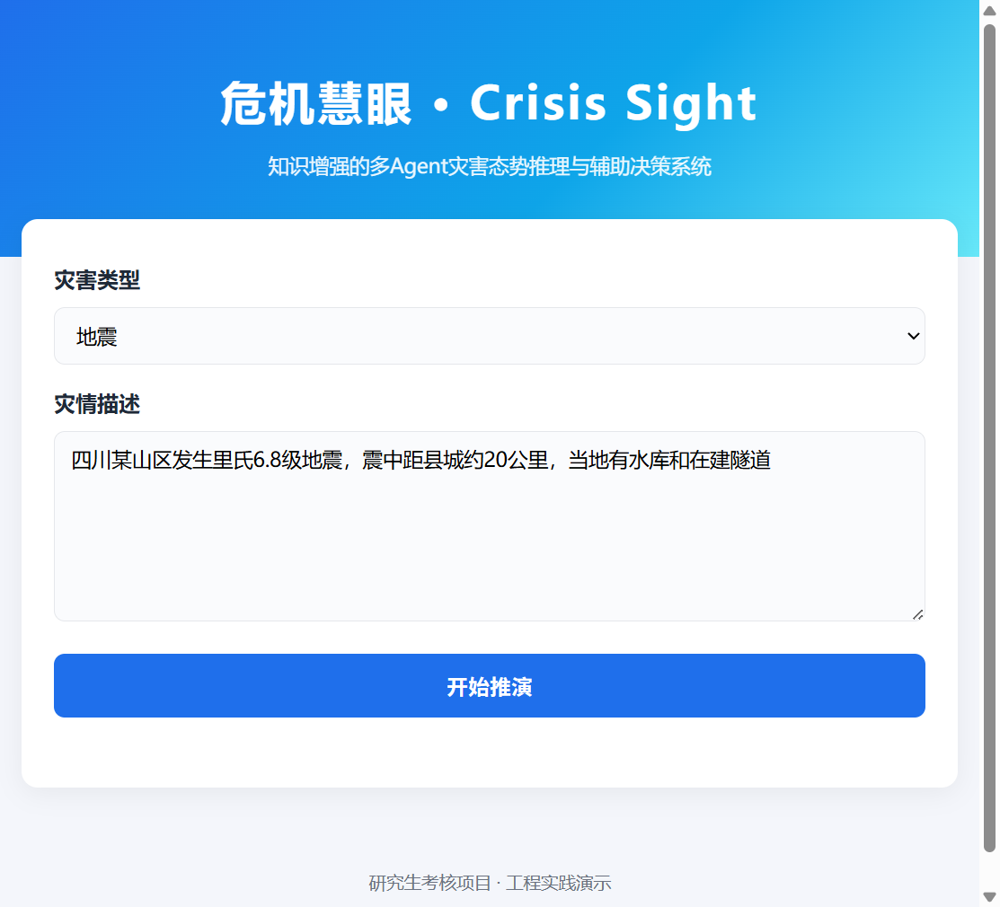
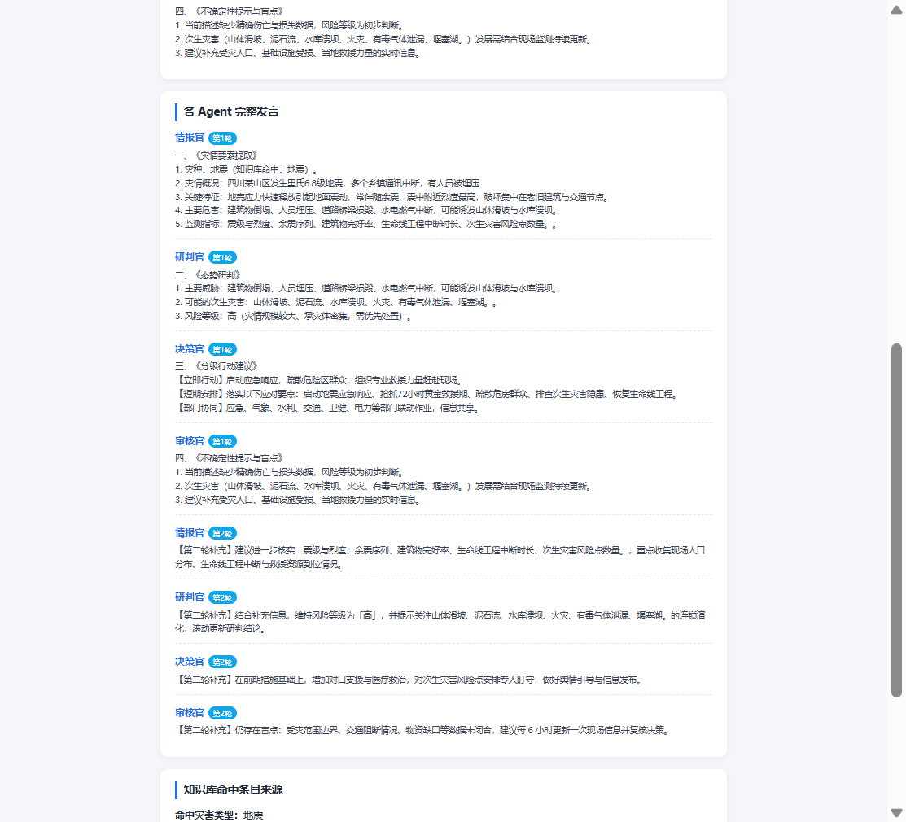

# 工程项目说明

> 项目介绍 + 功能说明 + 运行截图

## 项目名

CrisisSight（危机慧眼）· 知识增强的多 Agent 灾害态势推演系统

## 项目简介

把自己科研方向（知识增强的多 Agent 灾害态势推理与辅助决策）落成一个能跑的 Web 系统：
用户输入一段灾情描述，四个智能体（情报官 → 研判官 → 决策官 → 审核官）按顺序各发言两轮，
发言时强制注入内置灾害知识库的条目，最后汇总成四段式决策建议报告。
不用任何外部 API Key 也能跑（demo 模式，模板规则确定性输出），配了 DeepSeek Key 就切到 LLM 模式真实推理。

## 功能列表

- [x] 灾情描述 + 灾害类型输入（10 类灾害：地震/洪涝/台风/山火/滑坡/泥石流/化工泄漏/城市内涝/寒潮/其他）
- [x] 四 Agent 两轮编排：情报官（提取要素）→ 研判官（态势研判+风险等级）→ 决策官（分级行动建议）→ 审核官（不确定性提示与盲点）
- [x] 内置灾害知识库增强：每个 Agent 的发言都注入命中条目的特征/危害/应对要点/次生灾害/监测指标
- [x] 双模式运行：demo 模式免 Key 离线可跑；LLM 模式直连 DeepSeek API（失败自动回退模板，保证不崩）
- [x] 前端展示：决策建议报告 + 各 Agent 两轮完整发言 + 知识库命中来源

## 技术栈

- 语言：Python
- 框架：Flask（Web 后端 + 静态页面托管）
- 前端：原生 HTML / CSS / JavaScript（无框架）
- 模型接口：requests 直调 DeepSeek chat/completions（optional，仅 LLM 模式需要）
- 数据库：无（知识库存内存字典，简单够用）

## 运行方式

```bash
# 1. 进到项目目录
cd engineering/src/crisis-sight

# 2. 装依赖（只需要 flask）
pip install -r requirements.txt

# 3. 启动（没配 Key 自动进入 demo 模式）
python app.py

# 4. 浏览器打开
# http://127.0.0.1:5000/
```

想用 LLM 模式（真实大模型推理），启动前设好环境变量：

```bash
# PowerShell
$env:DEEPSEEK_API_KEY = "sk-你的key"
```

不设 Key 也完全能跑，demo 模式的发言是知识库 + 模板规则拼出来的，用来演示流程、验证前后端没问题。

## 项目结构

```
crisis-sight/
├── app.py             Flask 主程序（/ 首页 + /api/analyze 分析接口）
├── agents.py          四 Agent 两轮编排（demo/llm 双路径）
├── kb.py              10 类灾害中文知识库 + 别名映射 + 命中查找
├── config.py          读环境变量 DEEPSEEK_API_KEY
├── requirements.txt   只依赖 flask
├── README.md          本项目更细的说明
└── static/            前端三件套（index.html / style.css / app.js）
```

## 设计思路（为什么这么做）

1. **为啥是四 Agent 流水线**：情报、研判、决策、审核正好对应态势推理的四个环节，最后加一个"审核官"是因为上个月读的论文里反复提到 LLM 会瞎编——让一个角色专门挑盲点，比让一个模型一口气给结论更稳。
2. **知识库为什么要强行注入**：demo 模式出的是确定性内容，LLM 模式每条发言都带知识库条目，这就是课题里"知识增强"的落地方式——先锚定事实再推理，降低幻觉。
3. **为什么搞 demo 模式**：评审/自己随时想跑都能跑，不烧钱；想验证真实推理效果再开 Key。

## 运行截图

| 首页 | 推演结果（四个 Agent × 两轮发言） |
|------|------|
|  |  |

结果页底部（知识库命中来源）见 [screenshots/result-bottom.png](screenshots/result-bottom.png)。

详细源码见 `src/crisis-sight/`，接口和数据结构的说明在 `src/crisis-sight/README.md`。