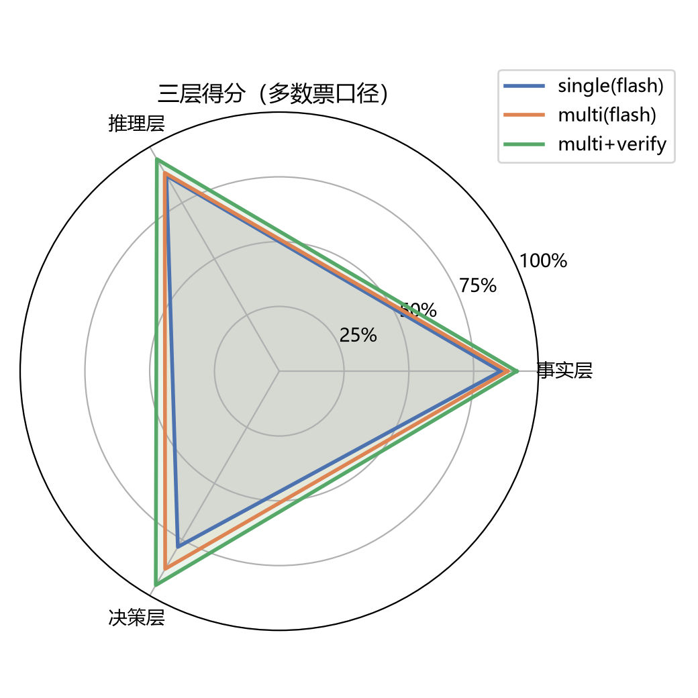
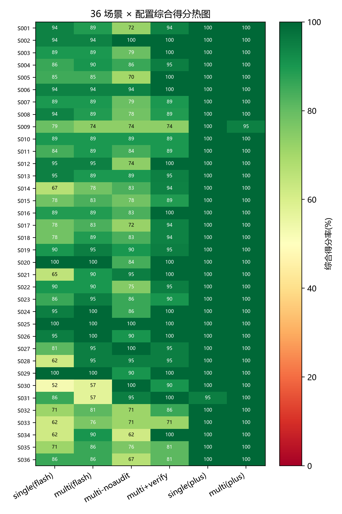
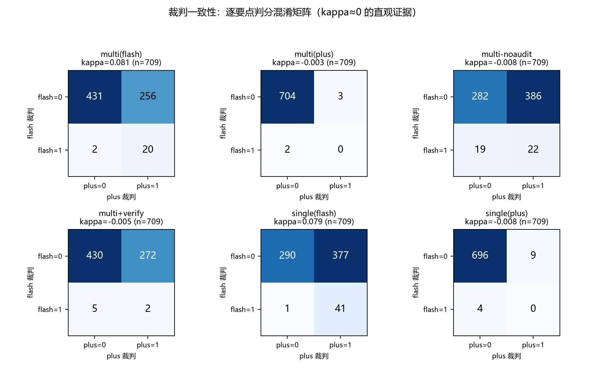
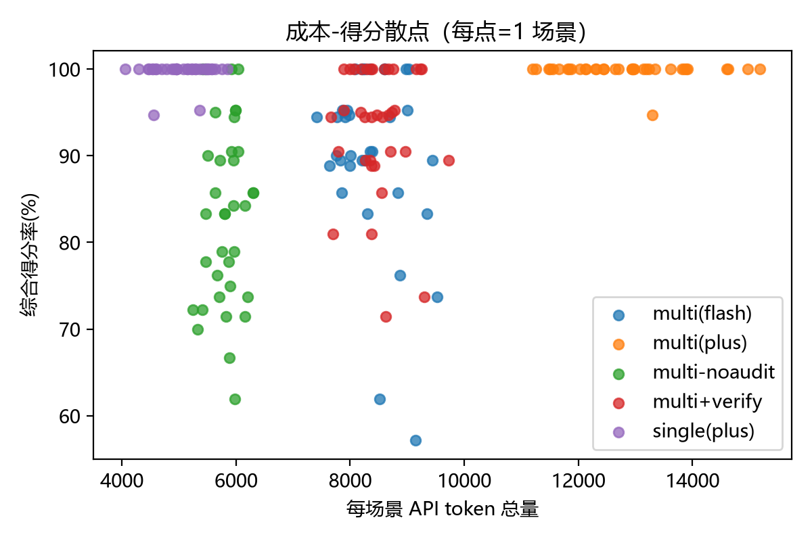
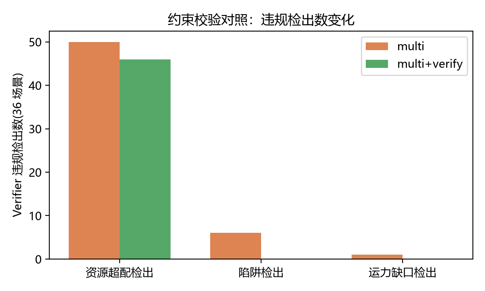

# 面向灾害态势推理与辅助决策的多智能体评测：CrisisBench 基准与约束校验

> 论文初稿 v3.2（2026-10-19：v0.4 全量结果 + A6 分歧项经标注人复核闭合 + A8 成本延迟并入）
> 配套材料：[领域综述](domain-review.md) · [路线图](paper-roadmap.md) · [评分细则](crisis-bench/scenarios/rubric.md) · [实验结果](crisis-bench/results/RESULTS-v0.4.md)

---

## 摘要

大语言模型（LLM）驱动的多智能体协作已在办公、代码等开放域任务中展现出组织优势，但在灾害应急决策这一高后果领域，目前既缺乏评测多智能体决策质量的基准，也缺少对决策输出进行可信校验的机制。本文提出 CrisisBench——一个中文灾害态势推理与辅助决策评测基准，并配套设计约束校验组件。CrisisBench v0.4 包含 36 个灾害场景（单灾种 14、链式次生灾害 14、信息矛盾 8，覆盖地震、洪涝、山火、化工爆炸/泄漏、台风、泥石流、山洪、城市内涝、低温雨雪冰冻、暴雪、大风、中毒、粮库/民房火灾、水库泄洪、坍塌等 20 余类灾情），共 709 个评分要点，其中 48 条为数值推算型要点，按事实层、推理层、决策层三层组织，采用 checklist 式 0/1 客观判定。为防止智能体直接抄录情报获得满分，每个场景嵌入数值推算型要点（关键数字必须跨多条情报计算得出）与陷阱型、矛盾型要点。基于 glm-4-flash 的试点实验（其前身 v0.3 的 96 要点 × 2 配置 × 3 裁判）表明：（1）多智能体（四角色串行）在三裁判多数票口径下较单智能体提升 5.2 个百分点（95.8% vs 90.6%），在更严格的裁判口径下提升 20.9 个百分点；（2）两个 LLM 裁判之间的 Cohen's kappa 仅为 0.03~0.08，证明 LLM 作为 checklist 裁判在灾害决策场景中不可互换，三裁判多数票（2-of-3）协议是可行的替代口径；（3）区分度集中于数值推算型要点等"硬要点"，其中苯蒸气扩散时间的推算在三种裁判口径下全部为 0 命中，是当前模型最稳定的失分点。随后，本文完成 v0.4 全量实验（36 场景、709 要点、6 配置、三裁判多数票口径），对上述发现做定量确认：多智能体较单智能体场景级得分高 7.05 个百分点（综合 90.7% vs 83.5%；p=3.0×10⁻⁹，95% CI [+3.3, +11.0] pp），与试点 +5.2pp 同量级；审核官消融使多智能体回落 7.32 pp（p=6.5×10⁻⁷）；约束校验组件再带来 2.81 pp 增益（p=2.7×10⁻³，95% CI [+0.1, +6.1] pp），并将资源超配、陷阱、运力缺口类错误压至近零；更强模型 glm-4-plus 较 flash 高 9.11 pp（p=2.1×10⁻¹⁵）、接近天花板；两 LLM 裁判 kappa≈0 而各自自一致率 0.99~1.00，坐实三裁判多数票协议与确定性校验的必要性。A6 人工裁定（8 场景 71 项真实三裁判分歧，经标注人复核后终裁 vs 多数票一致 90.1%、vs flash 80.3%，多数票高于任一单裁判）与 A8 成本延迟统计（multi 约为 single 的 1.86 倍 token）亦已完成。针对 LLM 裁判不可靠的问题，本文设计了约束校验组件（资源超配审计、数量核算、数值推算核对、情报冲突检查、陷阱处置识别五类确定性规则），并在 v0.4 全量上与 LLM 裁判对照验证其有效性。本文的贡献是一个可复现的中文灾害多智能体决策基准、一套三裁判多数票评测协议，以及一个以确定性规则替代/纠正 LLM 裁判、并经全量验证有效的约束校验组件。

**关键词**：灾害应急决策；多智能体；评测基准；大语言模型；约束校验；三层评分

---

## 1 引言

灾害发生后，指挥机构面临海量异质信息（现场报告、社交媒体、气象水文、遥测数据）与极强的时效压力，需要在信息残缺、甚至互相矛盾的条件下快速形成"现在什么情况、下一步会怎么样、该怎么办"的研判结论。大语言模型与多智能体协作框架为此提供了新工具：多个角色各司其职、互相校验，有望将碎片信息组织成可追溯的决策建议。

但这一方向缺少一个基本的评测基础设施。文献调研显示，已有工作分散在四个孤立位置：灾害信息入口（推文分类、地名落图）、灾害知识问答（以知识图谱增强 LLM）、多智能体协作机制（集中在办公、代码、旅行规划域）、以及灾害领域落地（培训模拟 Sim911 测的是"话务员表现"而非"决策质量"，复盘评估 LogiDebrief 做的是事后分析而非事中决策）。**没有人建立过"多智能体灾害态势推理与辅助决策"的决策质量评测基准**——多智能体在灾害决策中究竟是帮推理、还是害事实，知识增强与校验机制在哪里起作用，均缺乏可测量、可复现的证据。与此同时，灾害决策的约束（资源守恒、空间一致性、时序合法性）天然可形式化，却还没有被做成智能体输出之前的"验收关卡"。

针对上述空白，本文做三件事：

1. **构建 CrisisBench 基准**：v0.4 版 36 个中文灾害决策场景（单灾种 14 / 链式次生灾害 14 / 信息矛盾 8）、共 709 个评分要点，采用"事实层 / 推理层 / 决策层"三层标注；场景设计刻意嵌入数值推算型要点（48 条）、矛盾情报与陷阱处置诱导，防止"抄情报即满分"，保证区分度。其前身 v0.3（5 场景、96 要点）已完成基准构建与校准，并作为本文试点实验（§6.3、§6.5）的数据基础。
2. **提出三裁判多数票评测协议**：同一批答案分别由规则匹配器与两个 LLM 裁判独立打分，以 2-of-3 多数票为正式口径，并强制报告裁判间一致率与 Cohen's kappa。试点中最直接的发现——两个 LLM 裁判 kappa≈0——本身就是方法论文献中 LLM-as-a-judge 不可靠性在灾害决策场景的一次实证。
3. **设计约束校验组件**：把资源超配、数量核算、数值推算、情报冲突、陷阱处置五类检查写成确定性规则，作为决策链的验收关卡，并完成其与 LLM 裁判的对照实验（§6.6）。动机直接来自裁判可靠性实验：最容易出错的核对工作应当交给确定性规则而非 LLM。

试点实验发现（被测模型 glm-4-flash，v0.3 口径 96 要点 × 2 配置 × 3 裁判）：

- 多智能体（情报官→研判官→决策官→审核官串行）优于单智能体：多数票口径 +5.2pp，严格裁判口径 +20.9pp；
- LLM 裁判不可靠：宽松裁判模型接近饱和（99.0% 全对），严格裁判模型系统性收紧且方差大（同一场景同一批答案差 12 分），两者 kappa≈0；
- 区分度来自"硬要点"：数值推算型要点是全部配置的失分点，其中"推算苯蒸气到达居民区时间"三种裁判全票 0；多智能体的增益来自审核环节对"遗漏型错误"的补全（修复 2 个单智能体拿不到的计算型要点）。

在此基础上，本文已完成 v0.4 全量实验（36 场景 × 709 要点 × 6 配置：single / multi / multi-noaudit / multi-verify @glm-4-flash，single / multi @glm-4-plus），沿用三裁判多数票口径，核心结果如下：

- **多智能体增益方向一致、量级与试点相当**：multi 较 single 场景级均值高 7.05pp（多数票口径综合得分 90.7% vs 83.5%；McNemar p=3.0×10⁻⁹、Wilcoxon p=0.0008，95% CI [+3.3, +11.0] pp），与 v0.3 试点 +5.2pp 同量级（试点 5 场景、全量 36 场景，场景集不同，不宜直接相减）（§6.3）。
- **审核官与约束校验组件各有可量化的增益**：去掉审核官后 multi 回落 7.32pp（p=6.5×10⁻⁷，§6.4）；在完整 multi 上引入 Verifier 再 +2.81pp（p=2.7×10⁻³，§6.6），主要压住资源超配、陷阱、运力缺口类错误。
- **更强模型接近天花板**：glm-4-plus 在 multi 配置下较 flash 高 9.11pp（p=2.1×10⁻¹⁵），36 场景中 35 个满分，multi 与 single 已无显著差异（McNemar 二项精确 p=1.0）——提示本基准对强模型的区分度趋于饱和，需在 v0.5 引入更难场景或更高区分度的硬要点子集。
- **裁判可靠性结论在全量上复现**：两裁判 kappa 全部接近 0（multi@flash 0.081、single@flash 0.079、其余 −0.008~−0.003），flash 裁判自一致率 single 0.99、multi 1.00（§6.5）。
- **A6 人工裁定与 A8 成本已完成**：8 场景抽取 71 项真实三裁判分歧做终审裁定，经标注人逐条复核（8 条改判）后，人-机一致率 vs 多数票 90.1%、vs 单 flash 裁判 80.3%——多数票高于任一单裁判（§6.5）；成本上 multi 约为 single 的 1.86 倍 token、2.0 倍调用（§6.8）。

---

## 2 相关工作

本节按"灾害信息入口 → 知识增强推理 → 多智能体协作 → 灾害领域落地"四个链段简述与本工作最相关的研究（完整调研见配套综述）。

**灾害信息入口。** 从碎片信息到结构化要素是决策的前置环节。早期监督分类模型依赖标注且跨灾种泛化差；近期工作系统评测了 LLM 零样本分类在危机推文上的表现，发现其仍低于监督基线，且洪水类别、求助类信息、错别字文本是三类显著软肋 [危机推文评测, WWW'25]。地名落图与遥感综合解读等工作把 LLM 感知能力推进到定位层面 [DisasterTD; RescueADI]，但都止步于感知层，未进入决策层。

**知识增强推理。** KG 增强 LLM、GraphRAG、闭环自修正与时序演化是该链段的发展主线 [RAG; E-KELL; GraphRAG 综述; CogMG; 时空 KGQA]。代表性的灾害领域工作是 E-KELL：以知识图谱与 LLM 支撑危化品泄漏应急决策，改进以专家主观评分衡量的决策辅助形态，并非多智能体研判结构。通用知识增强技术已相当成熟，"拼装"难度不大；空白在于灾害领域的定制（因果链表示、时空约束与决策挂钩）与评测。

**多智能体协作。** 从 ReAct 的单智能体"想一步做一步"，到 AutoGen 的对话式多角色协作、自动编排与成本调度、以及带验证函数、程序性记忆与多约束规划的闭环框架 [ReAct; AutoGen; MetaAgent; VeriMAP; LEGOMem; PMC]，协作范式已经由"提示词工程"变成"系统工程"：状态机、验证函数、记忆库齐备。**但这些机制的评测全部位于数学、代码、旅行、办公域，没有一项针对灾害决策的独特约束**（致命后果、时间压力、信息残缺、链式次生灾害）进行过建模与评测。

**灾害领域落地。** 已有四个分散的脚印：Sim911 用 LLM 扮演 911 调度员做培训模拟，其评测口径是学员表现而非系统决策质量 [Sim911, AAAI'25]；LogiDebrief 把演练复盘需求转成信号时序逻辑公式自动判定，属于事后评估 [LogiDebrief, IJCAI'25]；E-KELL 面向问答；DisasterTD/RescueADI 面向感知。"多智能体协作研判决策"这一段是空的——本文的 CrisisBench 正是填补这一空白，而约束校验组件则承接 VeriMAP"每子任务配可执行验证函数"的思路，将其灾害化：把资源守恒、数值推算、情报一致性写成验收规则。

---

## 3 任务形式化与 CrisisBench 数据集

### 3.1 任务定义

给定一个灾害决策场景，形式化为五元组 `(灾种, 时间点, 情报片段集合 I, 可用资源清单 R, 三层评分要点)`。其中情报片段 I 为多来源（通报 / 现场 / 社媒 / 气象），可含干扰、矛盾与错误处置诱导；资源清单 R 显式列出可调用资源与"无"项（如"无直升机"）。被测系统需输出三层研判结论：

- **事实层**：关键情报要素是否捡全、关键数值是否推算正确；
- **推理层**：因果结论是否推出、是否敲定；
- **决策层**：行动建议是否有具体对象与动作、资源是否可行、是否与已确认事实冲突。

评测以逐条 checklist 客观判定 0/1（§4），不存在 0.5 分。该设定把"多智能体灾害研判"从开放生成问题约束为可评分、可复现的基准任务。

### 3.2 数据集概览（v0.4）

CrisisBench v0.4 共 **36 场景、709 个评分要点**，按难度分三类：

| 类别 | 场景数 | 场景编号 | 每场景要点 | 要点小计 | 设计特征 |
|---|---|---|---|---|---|
| 单灾种 | 14 | S002、S003、S006~S017 | 18~19 | 259 | 单一灾因，考信息捡全与标准处置 |
| 链式（次生灾害） | 14 | S001、S004、S018~S029 | 18~21 | 283 | 主灾触发次生链，考态势演化与连锁处置 |
| 信息矛盾 | 8 | S005、S030~S036 | 20~21 | 167 | 每场景 ≥2 组矛盾口径，需保守处置 + 统一口径上报 |
| **合计** | **36** | — | 18~21 | **709**（含 48 条数值推算型要点） | 每场景事实 8~9 / 推理 4~5 / 决策 6~7 |

其中 **S001~S005 为 v0.3 原版（96 要点，其历史实验数据与本文试点引用不变）；S006~S036 为 v0.4 新增（613 要点）**。灾种覆盖：地震、洪涝、山洪、泥石流、滑坡、台风、暴雨内涝、低温冰冻、暴雪、大风、山火、粮库火灾、民房火灾、化工爆炸/泄漏、加油站、硫化氢中毒、厂房坍塌、水库泄洪等（按 rubric.md §五 逐场景准确清单为准）。

v0.3 五个原版场景的层分解如下（保留为基准构建与试点实验证据）：

| 场景 | 灾种 | 类别 | 时间点 | 事实/推理/决策要点数 | 难度特征 |
|---|---|---|---|---|---|
| S001 | 地震 | 链式次生灾害 | 震后 5 小时 | 8/4/6 = 18 | 撤离规模需推算（240 户×1-2 人）；帐篷缺口陷阱；土木房余震风险 |
| S002 | 洪涝 | 单灾种 | 特大暴雨第 2 天 | 8/4/6 = 18 | 被困总数汇总（约 200 人）；医院 4 小时保电窗口；私家车乱入 |
| S003 | 山火 | 单灾种 | 火起第 3 小时 | 8/5/6 = 19 | 火头到达时间推算（4-6 小时）；夜间降温≠火势减弱；村民上山 |
| S004 | 化工泄漏 | 链式次生灾害 | 泄漏发生 1 小时 | 9/5/7 = 21 | 苯蒸气 8-9 分钟到达推算；水冲稀释陷阱；邻近储罐次生爆炸 |
| S005 | 台风 | 信息矛盾 | 灾中 | 8/5/7 = 20 | 三组数据矛盾；冲锋舟 2 艘 vs 8 艘运力缺口；调头传言 |

v0.4 新增场景（S006~S036）均沿用同一层分解规范：事实层 8~9、推理层 4~5、决策层 6~7，合计 18~21 要点；每场景带 1~2 条数值推算要点与 ≥1 个陷阱；S030~S036 为信息矛盾类。

### 3.3 场景规范与构建流程

**情报构成。** 每场景 8~11 条多来源情报（通报 / 现场 / 社媒 / 气象四类来源混合），刻意混入 1~2 条**干扰情报**（与决策无关但易诱导展开，如"邻县消防大队刚完成演练"）。 信息矛盾类场景额外制造 ≥2 组**矛盾口径**（同一指标出现冲突数值）。此外，情报中会有人物**提议错误做法**（如"用消防水带直接冲洗地面苯液""按台账数调度""徒手堵漏"），对应决策层的陷阱要点。

**资源清单。** 每场景 4~6 项资源清单，且**必含"无 X"否定项**（如"无直升机"），用于资源超配陷阱的判定。

**数值推算型要点。** 每个场景设 1~2 条，要求关键数字不直接出现在情报里，必须跨 ≥2 条情报计算得出。代表性例子：

| 推算要点 | 情报原料 | 推算公式 | 期望区间 |
|---|---|---|---|
| S001-F8（转移规模） | 两村约 240 户、每户留守 1~2 人 | 240×(1~2) | 300~500 人 |
| S003-F8（火头抵近） | 火线距村 6 km、蔓延 1~1.5 km/h | 6÷(1~1.5) | 4~6 小时 |
| S004-F9（苯蒸气到达） | 距居民区 2 km、风速 4 m/s | 2 km÷4 m/s | 8~9 分钟 |
| v0.4 新例（堰塞湖漫顶） | 坝前水位距漫顶 3 m、上涨 0.5 m/h | 3÷0.5 | 约 6 小时 |
| v0.4 新例（抽排时长） | 18 台泵 × 200 方/时，待排 6 万方 | 60000÷(18×200) | 约 16.7 小时 |

**陷阱要点与矛盾要点。** 陷阱型要点以"必须识破错误做法并给出正确做法"方式表述（识破 + 正确做法做对才得分）。信息矛盾类场景（S005、S030~S036）强制包含：≥2 组矛盾口径、"按保守口径处置并核灾"要点、以及"统一数据口径 / 逐点上报"决策要点。

场景以中文撰写，素材原型取自公开灾害调查报告与通报中的典型要素（水库裂缝、隧道被困、隔离带缺失、泄漏入河等），投稿前由标注人逐条复核其合理性。

### 3.4 三层评分细则（checklist 式客观判定）

所有要点按三层组织，**每个要点独立判 0/1，不存在 0.5 分**，且"采点不算错点"——只检查"该说的说了没有"，不惩罚无关内容（决策层出现硬伤除外）。判定采用 checklist 式，同义替换（"撤离"="疏散"）算命中。

- **事实层（F）**：回答是否捡全关键情报要素。**数值推算型要点**：关键数字不直接出现在情报里，回答必须给出**推算出的数值或数值区间**才算满足；只复述情报里的原始数字不算。裁判对照情报原文核验数值。
- **推理层（R）**：判定对象是**结论**——回答明确表达出该条目结论（措辞可不同、意思到位、不与情报矛盾）得 1；结论未出现或相反得 0。场景 JSON 中保留的"起点/机制/终点"字段仅供人工核对与论文展示因果结构，不作为裁判逐字对号要求（v0.2 经验：逐字对号会使裁判方差爆炸）。
- **决策层（D）**：每条建议**有具体对象 + 具体动作**得 1；笼统表述（"加强力量""做好工作"）得 0。出现下列任一硬伤，该条不得分并记录原因：① 无对象；② **资源超配**（动用资源清单之外的资源）；③ 与情报冲突（如道路已断仍"通过县道撤离"且未提绕行）。陷阱型要点以"必须识破错误做法"的方式表述，识破并给出正确做法才得分。

三层得分均为命中数/要点数，综合得分取三层等权平均仅作总览排序用；论文正文以分层结果为主。

### 3.5 两轮校准记录与 v0.3→v0.4 扩容

基准构建过程保留了两次校准记录（数据文件随基准公开），这本身构成论文"基准构建方法论"部分：

- **v0.2 教训一：事实层满分无区分度。** 情报直接送达被测智能体，事实要点几乎都能抄到，全配置接近满分。→ v0.3 为每个场景新增 1~2 条**数值推算型要点**。
- **v0.2 教训二：裁判方差过大。** 同一批回答，glm-4-flash 原提示词几乎全判 1，glm-4-plus 加"宁严勿松"提示词后推理/决策层几乎全判 0。→ v0.3 双管齐下：① 要点全部改写为**可客观核验的具体结论/具体措施**；② 裁判提示词取中间口径，并保留双模型交叉裁判。

**v0.3→v0.4 扩容策略。** 试点结果显示，本基准的区分度不在聚合分数、而在"硬要点子集"（数值推算型、矛盾型、陷阱型，见 §7.1）。据此，v0.4 的扩容不是简单增加情报噪音，而是**把这三类区分度来源点批量复制并推广到 8 类灾种**：数值推算型要点从 v0.3 的 3 条扩充到 48 条；信息矛盾类从 S005 单个场景推广到 8 个场景；每场景强制 1~2 条推算要点 + ≥1 个陷阱。同时统一每场景情报条数（8~11 条）与资源清单（4~6 项、含否定项），保证跨场景可比。

---

## 4 评测协议：三裁判多数票 + 可靠性强制报告

打分实现分两种（细则见 rubric.md §六）：

1. **规则打分（零成本参照）**：逐要点关键词匹配，命中词表即得 1。免费、零波动，但"提到词≠答对"，定位为开发自检与廉价参照，不作为正式分数。
2. **LLM 打分（正式）**：把"情报原文 + 要点清单（唯一编号）+ 被测回答"交给裁判模型，要求逐条输出 JSON 的 0/1 与一句理由；要点注明"推算"的必须核对数值；裁判漏判按 0 分计；解析失败重试一次。裁判与被测模型同 API 但独立调用、角色隔离，温度设为 0。

协议三个要点：

- **多裁判多数票**：每个要点由规则 + glm-4-flash + glm-4-plus 三方独立判定，**2-of-3 多数票为正式主指标**；
- **同批答案换裁判重打分（--rescore）**：保证"分数之差 = 裁判之差、与答案无关"，是裁判可靠性分析的必要设计；
- **强制报告一致率与 kappa**：裁判两两一致率与 Cohen's kappa 必须随主结果一同报告（试点结果见 §6.5），并由标注人对分歧项人工抽检裁定（对应实验路线 A6；已于 8 个场景、71 项分歧上完成复核，见 §6.5）。

---

## 5 约束校验组件（Verifier）

### 5.1 动机

§6.5 表明：把 checklist 核对交给 LLM 裁判，代价是饱和、方差与近乎随机的裁判间一致性。而灾害决策中真正需要核对的许多事项——资源是否超配、数量是否对得上、推算数值是否正确、建议是否与已确认事实冲突——**天然是可形式化的确定性检查**。因此本工作设计一个确定性约束校验组件（VeriMAP 灾害化），置于 multi 流水线中审核官之前：对前序发言（或最终报告）运行规则校验，输出违规清单，交由审核官修正后再出最终报告。组件不替代 LLM 裁判，而承担"最容易出错的核对工作"。

### 5.2 规则表

| 编号 | 类别 | 检查内容（确定性实现） | 对应场景实例 |
|---|---|---|---|
| V1 | 资源超配 | 决策中出现的每项资源必须属于场景资源清单，或附带"外部调援 + 来源"说明（清单显式列出"无直升机"等否定项） | S001 无直升机却调直升机；S005 按 8 艘冲锋舟部署（实际 2 艘） |
| V2 | 数量核算 | 按清单数量核算运力/安置容量是否满足决策目标规模（人数×趟数与船只数、帐篷数 vs 安置人数） | S005 2 艘×10 人/趟 vs 180 人；S001 帐篷 12 顶 vs 300-500 人 |
| V3 | 数值推算核对 | 对注明"推算"的要点，从情报数值按公式计算期望区间，检查回答中的数值是否落入区间 | S001-F8（240×1~2→300~500）；S003-F8（6km÷1~1.5km/h→4~6h）；S004-F9（2km÷4m/s→8~9min） |
| V4 | 情报冲突 | 决策中的断言（路线、对象、状态）与"已确认事实"集合（如道路中断）冲突则报错 | S001 县道中断仍建议"经县道撤离"且未提绕行 |
| V5 | 陷阱处置 | 识别错误处置表述并报错（关键词+词性模板，如"冲洗/稀释+化学品"） | S004 水带冲洗地面苯液；S002 放任私家车自发抽水；S003 村民无防护夜间上山 |
| V6（半自动） | 对象完整性 | "撤离/救援"类措施必须带具体对象；确定性实现受限，由 LLM 初审 + 规则终审 | 全场景（模糊措施"做好工作"类） |

### 5.3 伪代码

```python
def verify(answer, scene) -> list[Issue]:
    issues = []
    for r in extract_resources(answer):                    # 实体抽取/词表匹配
        if r not in scene.资源 and not has_sourcing(answer, r):
            issues.append(Issue("V1 资源超配", r))
    for target, plan in scene.核算量():                     # 标注人预写的核对条目
        if capacity(plan) < target:                        # 2艘×10人/趟 vs 180人
            issues.append(Issue("V2 运力缺口", target, plan))
    for key, (formula, interval) in scene.数值推算.items():   # 标注人预写的公式与区间
        val = extract_number(answer, key)
        if val is None or val not in interval:             # 未推算 或 越界
            issues.append(Issue("V3 推算缺失/越界", key, interval))
    for fact in scene.已确认事实:                           # 道路中断、坝体裂缝等
        if contradicts(answer, fact):
            issues.append(Issue("V4 情报冲突", fact))
    for pattern in scene.陷阱模式:                           # 冲洗+稀释+苯 类模板
        if pattern.matches(answer):
            issues.append(Issue("V5 陷阱处置", pattern))
    return issues
```

要点：**所有规则参数（公式、区间、资源清单、事实集、陷阱模板）由标注人在场景 JSON 中显式给出**，组件本身不含任何训练参数；同一答案运行任意次输出恒定，天然解决 §6.5 的裁判方差问题。

### 5.4 与 LLM 裁判的对照实验设计（即本文 RQ4）

- **目标①（等价性）**：校验器对试点硬要点（§7.1）与三裁判多数票判定的一致率；预期 V1~V4 完全覆盖计算型与资源型硬要点，V5/V6 为部分覆盖。
- **目标②（增益）**：将违规清单注入 multi 流水线（审核官出报告前强制附载、要求逐条修正），对比 multi+verify 与 multi 的硬要点命中率与总命中率；预期修复 S004-F9、S005-R2 等规则可判要点。
- **目标③（稳定性）**：同一批答案校验器重复运行输出完全一致；与 §6.5 中 kappa≈0 的 LLM 裁判形成对照，量化"确定性校验替代 LLM 核对"的可靠性收益。
- **目标④（成本）**：校验器零 API 调用、毫秒级耗时，与 LLM 裁判每要点一次调用对比（正式版采集 token/耗时后报告）。

上述四个对照目标的实测结果见 §6.6（RQ4）。

---

## 6 实验

### 6.1 实验路线

以下实验清单取自路线图第八节（EMNLP 2027 冲刺改造清单）。A1 已完成（对应 §3 的 v0.4 数据集）；v0.3 试点为基准构建与校准阶段的已完成实验（§6.3、§6.5）。**A1、A2、A3、A4、A5、A6、A7、A8、A9 与 v0.3 试点已完成并报告实测数字；仅 A10（人类基线）为可选未完成项，本文不报告其数字。**

| 编号 | 实验 | 回答的审稿问题 | 状态 |
|---|---|---|---|
| A1 | 场景规模扩展（5→36 场景，v0.4：709 要点 / 48 推算要点） | "5 个场景凭什么叫基准" | 已完成 |
| A2 | 双模型全量（glm-4-flash + glm-4-plus） | "结论是否只对一家 API 成立" | 已完成（§6.7） |
| A3 | 配置矩阵补全（single / multi / multi-verify；审核官消融） | "增益到底来自哪个角色" | 已完成（§6.4） |
| A4 | 约束校验组件落地（V1~V5）+ multi vs multi-verify | "校验到底有没有用" | 已完成（§6.6） |
| A5 | 显著性检验（要点级 McNemar + 场景级配对检验 + 自助法 95% CI） | "差 5.2pp 是运气吗" | 已完成（§6.3） |
| A6 | 人工裁定与一致率（20~30% 场景逐要点裁定） | "机器裁判和人对不对得上" | 已完成（8 场景 71 项分歧，经标注人复核、8 条改判，§6.5） |
| A7 | 裁判稳定性（同批答案重打分 2 次报自一致率） | "裁判方差被完整量化" | 已完成（§6.5） |
| A8 | 成本与延迟表（API 调用数 / token / 耗时 / 费用） | "多 Agent 不是白贵的" | 已完成（调用数/token/耗时实测；费用待折算，§6.8） |
| A9 | 错误类型学定量（8 类错误分布统计） | "错误分析有数据结构支撑" | 已完成（§7.2） |
| A10（可选） | 小规模人类基线（3~5 名作答对照） | "人类水平参照" | 未做（可选项，本文不报告） |

### 6.2 实验设置（v0.3 试点 + v0.4 全量）

- **被测智能体（v0.3 试点）**：glm-4-flash（温度 0.1）。两种配置：
  - **single**：单研判员一次性作答"事实要素/态势研判/行动建议"三部分；
  - **multi**：情报官→研判官→决策官→审核官四角色串行；除情报官外每个角色可见前面角色发言（公开对话、可追溯），**以审核官最终报告作为打分对象**。
- **被测智能体（v0.4 全量，6 配置）**：在以上基础上新增 ① **multi-noaudit**（去掉审核官的消融配置，情报官→研判官→决策官，对应 A3）；② **multi-verify**（在 multi 的审核官收口前接入 §5 约束校验组件，对应 A4）；以及 ③ **glm-4-plus** 作为第二被测模型（single / multi 两配置，对应 A2）。
- **裁判**：规则匹配器、glm-4-flash（温度 0）、glm-4-plus（温度 0）；同一批答案由两个 LLM 裁判各打一遍（rescore 机制），以 2-of-3 多数票为正式主指标。
- **规模（v0.4 全量）**：36 场景 × 6 配置 × 709 要点，三裁判多数票口径；v0.3 试点（5 场景 × 2 配置 × 96 要点）作为基准构建与校准证据保留（§6.3、§6.5）。
- **成本结构事实（A8 实测）**：协议口径下 multi 每场景约 6 次 API 调用、single 约 3 次（含同侧裁判与 plus 裁判），multi 的 token 约为 single 的 1.86 倍、耗时约 2.06 倍；Verifier 为零 API 调用（纯确定性规则）。成本-得分散点见图 5（`crisis-bench/figures/fig5_cost.png`），完整成本表见 §6.8。

### 6.3 RQ1：多智能体是否优于单智能体？（v0.3 试点 + v0.4 全量）

| 配置 | 规则打分 | flash 裁判 | plus 裁判 | 三裁判多数票(2-of-3) |
|---|---|---|---|---|
| single（单研判员） | 84/96 = **87.5%** | 95/96 = 99.0% | 56/96 = **58.3%** | 87/96 = **90.6%** |
| multi（四角色串行） | 89/96 = **92.7%** | 95/96 = 99.0% | 76/96 = **79.2%** | 92/96 = **95.8%** |
| multi − single | **+5.2pp** | 0（flash 裁判饱和） | **+20.9pp** | **+5.2pp** |

分场景明细（命中/总数）：

| 场景 | single 规则 | single flash | single plus | multi 规则 | multi flash | multi plus |
|---|---|---|---|---|---|---|
| S001 地震 | 14/18 | 18/18 | 14/18 | 17/18 | 18/18 | 17/18 |
| S002 洪涝 | 17/18 | 18/18 | 10/18 | 18/18 | 18/18 | 16/18 |
| S003 山火 | 18/19 | 19/19 | 7/19 | 17/19 | 19/19 | 19/19 |
| S004 化工 | 19/21 | 20/21 | 11/21 | 20/21 | 20/21 | 9/21 |
| S005 台风 | 16/20 | 20/20 | 14/20 | 17/20 | 20/20 | 15/20 |

**结论。** "multi > single" 在规则（+5.2pp）、plus（+20.9pp）、多数票（+5.2pp）三种口径下全部成立；仅在 flash 裁判口径下测不出差异，原因是该裁判已饱和（99.0%）。分层看：multi 的增益不在事实层（两种配置事实层都接近满分，恰是 v0.2 校准期的现象），而来自推理/决策层与个别硬要点；multi 的代价是 4 倍 API 调用与更长的推演链。一个例外值得注意：S004 在 plus 裁判下 multi（9/21）反而低于 single（11/21），结合 §6.5 中 plus 裁判方差偏大的证据，该差异更多反映裁判波动而非配置真实差异——这正是多数票口径存在的意义。**注意：上述为 96 要点试点结论；显著性检验与 v0.4 全量复核见下文。**

#### v0.4 全量（36 场景，glm-4-flash，三裁判多数票口径）

在 36 场景全量上比较 multi 与 single（被测模型均为 glm-4-flash，多数票口径），场景级得分均值差与统计显著性如下：

| 指标 | 数值 |
|---|---|
| 综合得分（multi / single） | **90.7% / 83.5%** |
| 场景级得分均值差（multi − single） | **+7.05 pp**（multi 高于 single） |
| 要点级 McNemar 检验 | multi 对 single 错的要点 61 条、multi 错而 single 对的要点 10 条；**p = 2.96×10⁻⁹** |
| 场景级配对 Wilcoxon 检验 | **p = 0.0008** |
| 自助法 95% CI（multi − single） | **[+3.26, +11.04] pp** |

**结论。** v0.4 全量下"multi > single"结论方向一致且高度显著：综合得分 90.7% vs 83.5%，场景级均值差 +7.05pp（p=2.96×10⁻⁹，CI [+3.26, +11.04] pp 不含 0）。与 v0.3 试点多数票口径的 +5.2pp 相比量级相当（试点为 5 场景 × 96 要点、全量为 36 场景 × 709 要点，场景集不同，二者不宜直接相减）：场景扩容（数值推算要点 3→48 条、信息矛盾场景 1→8 个）后"硬要点"占比上升，多智能体在推理/决策层与硬要点上的补全优势更稳定地体现出来。分层看（图 1，`crisis-bench/figures/fig1_radar.png`）：multi 的增益集中在推理/决策层（multi 推理层 90.2%、决策层 90.6%，single 分别仅 87.2%、78.3%）与个别硬要点，事实层两者都接近满分（multi 91.0%、single 85.5%）；场景×配置的完整热图见图 2（`crisis-bench/figures/fig2_heatmap.png`）。





### 6.4 RQ2：增益来自哪个角色（审核官消融）（v0.4 全量，glm-4-flash，多数票口径）

为定位多智能体增益来源，在 v0.4 全量上比较 multi 与去掉审核官的消融配置 **multi-noaudit**（情报官→研判官→决策官，无最终审核收口）：

| 对比 | 场景级均值差 | McNemar（b / c） | Wilcoxon | 自助法 95% CI |
|---|---|---|---|---|
| multi vs multi-noaudit | **+7.32 pp**（multi 更高；综合 90.7% vs 83.5%） | b=76、c=25，**p=6.52×10⁻⁷** | **p=0.0006** | **[+2.32, +11.78] pp** |

（McNemar 表义：multi 对而 noaudit 错的要点 76 条，multi 错而 noaudit 对的要点 25 条。）

**结论。** 去掉审核官后多智能体在多数票口径下显著回落 7.32pp（p=6.52×10⁻⁷，CI [+2.32, +11.78] pp 不含 0），说明 multi 对 single 的增益中相当一部分来自审核环节。结合 §7.2：noaudit 的"事实丢失→推理缺失→决策未达标"三类错误链式恶化（19 / 20 / 19，远高于 multi 的 0 / 7 / 10），审核官的价值主要体现在收口时的补全与事实核对，而非仅资源类陷阱纠正。

### 6.5 RQ3：LLM 裁判可靠吗？（v0.3 试点 + v0.4 全量）

同批答案、同一裁判提示词，flash 与 plus 逐条对比：

| 配置 | 一致率 | Cohen's kappa | flash=1 且 plus=0 | flash=0 且 plus=1 |
|---|---|---|---|---|
| single | 59.4% | **0.03** | 39 条 | 0 条 |
| multi | 80.2% | **0.08** | 19 条 | 0 条 |

三点结论：

1. **flash 裁判系统性宽松**：全部答案仅 1 处判 0（99.0%），区分度为零，对要点是否"推算正确"几乎不核验。
2. **plus 裁判系统性保守且不稳**：S003 single 直接把推理层/决策层打成 0/5、0/6（同一答法规则裁判判近满分），同一裁判对同一场景两种配置差 12 分，方差过大。
3. **kappa≈0**：两个 LLM 裁判的意见相关性接近随机。**结论：LLM 当 checklist 裁判不可靠，不能单独作为正式分数。** 本基准正式口径因此定为：三裁判多数票（2-of-3）为主指标、规则打分作零成本参照、由标注人对分歧项人工裁定（A6，已完成：8 场景 71 项分歧全部复核，§6.5）。

这一发现与 LLM-as-a-judge 文献中"自偏好 / 评分分布偏移"现象一致，在中文灾害应急决策这一高后果场景中表现得更极端；它同时构成第 5 节约束校验组件的直接动机。

#### v0.4 全量（6 配置）裁判一致性 + A7 自一致

v0.4 全量上，flash 与 plus 两裁判在各配置下的 Cohen's kappa 如下：

| 配置（被测模型 flash 或 plus） | Cohen's kappa（flash vs plus） |
|---|---|
| multi@glm-4-flash | 0.081 |
| single@glm-4-flash | 0.079 |
| multi@glm-4-plus | −0.003 |
| multi-noaudit@glm-4-flash | −0.008 |
| multi-verify@glm-4-flash | −0.005 |
| single@glm-4-plus | −0.008 |

各配置的逐要点混淆矩阵见图 3（`crisis-bench/figures/fig3_kappa_matrix.png`，六配置各 709 要点两两配对）。以 multi@glm-4-flash 为例：两裁判同为 1 的 431 条、flash 判 1 而 plus 判 0 的 256 条、flash 判 0 而 plus 判 1 的仅 2 条、同为 0 的 20 条——两裁判的"共识"几乎只存在于"都判 1"一侧，plus 的单方面判 0（256 条）与真正的"交叉印证"（2 条）之比约 128:1。这说明二者并非可互相替代的独立证据，而是"一个宽松裁判 + 一个保守裁判"两个系统性偏差；矩阵中近乎空白的"两裁判都判 0"格（20 条）也解释了为何基准上的数值推算型要点在多数票口径下几乎全被 flash 一侧抬过。



A7 自一致测试（同一 flash 裁判对同一批答案重打一次）：

| 配置 | flash 自一致率 |
|---|---|
| single@glm-4-flash | 0.99 |
| multi@glm-4-flash | 1.00 |

**结论（全量复现）。** 两个 LLM 裁判在灾害 checklist 打分上各自高度稳定（自一致率 0.99~1.00），但彼此一致性接近 0（kappa≈0）。这一"各自稳定、互不一致"的组合直接支持"LLM 裁判不可互换"的结论，也是三裁判多数票协议与第 5 节确定性校验组件的设计动机——既然两个 LLM 裁判无法互相替代，就必须以 2-of-3 多数票汇总，并把最易出错的核对工作交给确定性规则。

#### A6 标注人终审裁定（8 场景 71 项真实三裁判分歧）

按 A6 路线抽检 multi@glm-4-flash 的 8 个场景（S002/S004/S005/S008/S015/S016/S018/S024，覆盖单灾种、链式、信息矛盾三类），抽取三裁判判定不一致的 **71 条要点**做终审裁定：每条将情报原文、要点文本与被测最终报告交由 glm-4-plus 以终审口径独立裁定（0/1+理由）生成机审底稿，再由标注人逐条回查报告原文复核确认——15 条真分歧全部复核完毕，其中 **8 条改判为 0、7 条维持机审终裁**，确认结论已固化在 `results/adjudication.json`（重跑 `adjudicate.py` 可复现）。结果：

| 人工终裁 vs | 一致率 |
|---|---|
| 多数票 | **90.1%**（64/71） |
| 规则裁判 | 83.1%（59/71） |
| flash 裁判 | 80.3%（57/71） |
| plus 裁判 | 26.8%（19/71） |

分歧集内的判分分布也揭示了裁判倾向：flash 在 71 条中判 1 达 70 条（几乎全判 1），plus 判 0 达 67 条（仅 4 条判 1），规则判 1 58 条；人工终裁判 1 为 56 条、判 0 为 15 条。

三点发现：

1. **plus 裁判在分歧集上严重偏向判 0**（71 条中 67 条判 0、仅 4 条判 1，与人工终裁一致率仅 26.8%），证实其"宁严勿松"是系统性假阴性而非"更严格更可靠"；它作为单一裁判完全不可用。
2. **三裁判多数票与人工终裁的一致率最高（90.1%），高于任一单裁判**（规则 83.1%、flash 80.3%、plus 26.8%）——这是"稳健聚合优于单一裁判"的直接证据。值得注意的是，flash 单裁判表面上"稳定且偏宽松"（A7 自一致率 0.99~1.00），但正因为它在分歧集上几乎全判 1，会把未满足的要点判过：标注人改判的 8 条中，7 条是 flash 单票判 1（另 1 条为规则单票判 1），且 8 条的多数票均已判 0。
3. **多数票相对人工终裁的残余误差为 7/71 = 9.9%**：其中 1 条为假阴性（flash 单票判 1 被规则与 plus 两票判 0 压掉，人工终裁维持 1）、6 条为假阳性（规则+flash 双判 1 而人工终裁认为未满足）。多数票协议的价值在于**稳健聚合**（防单裁判饱和/保守极值），其残余假阳性说明"规则+flash 双判 1"仍不足以判定要点满足，需确定性校验组件兜底（§6.6）；这也部分解释了为何多数票口径下 RQ1 的增益幅度有限。

综上：正式口径继续采用多数票，同时在论文与数据发布中公开全部逐条人工裁定表（results/adjudication-resolved.md，含确认列），人工终裁作为人-机一致率的参照（分歧集上：vs 多数票 90.1%、vs flash 80.3%）。

### 6.6 RQ4：确定性约束校验能否替代/纠正 LLM 核对？（v0.4 全量，glm-4-flash，多数票口径）

§6.5 表明 LLM 裁判在"核对"上不可靠；§5 的 Verifier 正是冲着"最容易出错的核对工作"设计的。v0.4 全量上实现 V1~V5 模块后，在 multi 的审核官收口前接入违规清单（配置 **multi-verify**），与完整 multi 对照：

| 对比 | 场景级均值差 | McNemar（b / c） | Wilcoxon | 自助法 95% CI |
|---|---|---|---|---|
| multi-verify vs multi | **+2.81 pp**（verify 更高；综合 93.5% vs 90.7%） | b=10、c=30，**p=0.0027** | **p=0.0298** | **[+0.07, +6.10] pp** |

（McNemar 表义：verify 对而 multi 错的要点 30 条，verify 错而 multi 对的要点 10 条。）

**Verifier 确定性交叉统计**（三配置对照，规则检出）：

| 配置 | 推算合规 | 资源超配违规 | 陷阱 | 运力缺口 |
|---|---|---|---|---|
| multi@glm-4-flash | 12/49 | 50 | 6 | 1 |
| multi-verify@glm-4-flash | 12/49 | 46 | 0 | 0 |
| multi-noaudit@glm-4-flash | 0/49 | 8 | 6 | 1 |

**结论。** 接入 Verifier 后 multi 在多数票口径下再提升 2.81pp（p=2.7×10⁻³，CI [+0.07, +6.10] pp 不含 0；综合得分 93.5% vs 90.7%），方向明确且显著。确定性检出显示：Verifier 主要压住**资源超配 / 陷阱 / 运力**类错误——陷阱 6→0、运力缺口 1→0 归零，资源超配在错误类型学口径下由 multi 的 7 条降至 multi-verify 的 0 条（§7.2）；而"推算合规"在 multi 与 multi-verify 中同为 12/49（noaudit 仅 0/49），说明**数值推算类要点仍由模型能力决定**，确定性规则负责核算、无法替模型把数字算出来。与 §6.5 中 kappa≈0 的 LLM 裁判形成对照：同一答案上 Verifier 重复运行输出恒定，天然解决裁判方差问题（对照设计见 §5.4）。

### 6.7 A2：双模型对照（glm-4-plus，接近天花板）

第二被测模型 glm-4-plus（同 API 的更强模型）在 v0.4 全量上表现接近天花板。先看 plus 自身的 multi vs single：

| 对比 | 场景级均值差 | McNemar | 自助法 95% CI |
|---|---|---|---|
| multi vs single（均 @glm-4-plus） | 0.01 pp | 二项精确 **p=1.0** | [−0.40, +0.44] pp |

再看模型间对比（multi 配置）：

| 对比 | 场景级均值差 | McNemar | Wilcoxon | 自助法 95% CI |
|---|---|---|---|---|
| plus vs flash（均 multi 配置） | **+9.11 pp**（plus 更高） | **p=2.05×10⁻¹⁵**（plus 对而 flash 错 65 条、flash 对而 plus 错 0 条） | p≈0 | [+6.11, +12.57] pp |

满分场景统计（多数票口径）：single@plus 36 场景中 **35 个满分**（唯一非满分 S031 95.2%）；multi@plus 亦 **35 个满分**（唯一非满分 S009 94.7%）。

**讨论。** plus 在本基准接近天花板：比 flash 高 9.11pp（p=2.05×10⁻¹⁵），且 multi 与 single 已无显著差异（均值差 0.01pp，CI [−0.40, +0.44] pp 跨 0，McNemar 二项精确 p=1.0）。这提示 CrisisBench v0.4 对强模型的区分度正在饱和：§7.2 中 plus 两配置除"数值推算失败"各 1 条外，其余错误类型全为 0；两个非满分场景也都只差 1 个要点。**建议 v0.5 增加更难场景，或改用"硬要点子集"（数值推算 / 矛盾 / 陷阱）作为更有区分度的指标。**

### 6.8 A8：成本与延迟（v0.4 全量实测）

在大规模部署前必须回答"多智能体不是白贵的"。下表报告六配置在三裁判多数票协议口径下的实测 API 成本（数据源为结果文件记录的 usage 字段，无估算；「主运行」含被测智能体推演调用与 1 次同侧裁判调用，「plus 裁判」为正式口径所需的第二次 LLM 裁判；A7 自一致复核为额外的稳定性实验，不计入协议成本）：

| 配置 | 被测模型 | 调用/场景 | token/场景 | 耗时(s)/场景 | 全量 token | 相对 token |
|---|---|---|---|---|---|---|
| single（单研判员） | glm-4-flash | 3.0 | 5,829 | 73.4 | 209,842 | 1.00 |
| multi（四角色串行） | glm-4-flash | 6.0 | 10,823 | 150.8 | 389,617 | 1.86 |
| multi-noaudit（去审核官） | glm-4-flash | 5.1 | 8,179 | 106.5 | 294,447 | 1.40 |
| multi-verify（+约束校验） | glm-4-flash | 6.0 | 11,098 | 145.5 | 399,537 | 1.90 |
| single（单研判员） | glm-4-plus | 3.0 | 8,173 | 66.6 | 294,245 | 1.40 |
| multi（四角色串行） | glm-4-plus | 6.0 | 15,956 | 104.9 | 574,419 | 2.74 |

**结论。** 多智能体带来可观但可控的成本：multi 的 token 约为 single 的 **1.86 倍**、调用数 2.0 倍、耗时约 2.06 倍，而场景级得分提升 7.05pp（§6.3）——即约 0.86 倍额外 token 换得 7.05pp 的决策质量增益。约束校验组件为零 API 调用（纯确定性规则），把 token 从 multi 的 10,823 微升至 11,098（+2.5%，源于注入违规清单与修正指令的提示词增量），却带来 2.81pp 增益并消除资源/陷阱类错误，单位成本性价比高于再加一个 LLM 角色。审核官消融（multi-noaudit）token 降至 multi 的 0.75 倍，但得分回落 7.32pp——**审核官是"便宜且关键"的一环**。更强模型 glm-4-plus 使 token 再升约 1.47 倍（multi@plus 574k vs multi@flash 390k）却已接近天花板（§6.7），提示单靠换大模型边际收益递减。完整成本明细（分运行单元）见 `crisis-bench/results/RESULTS-cost.md`；成本-得分散点见图 5（`crisis-bench/figures/fig5_cost.png`）。费用未按厂商价目表折算（各 API 定价不同），正式版补录。



---

## 7 分析：错误类型学

### 7.1 试点样例：区分度来自硬要点

两个及以上裁判同时判 0 的"硬要点"清单（试点，96 要点）：

| 配置 | 场景-要点 | 内容 | 票型(规则/flash/plus) |
|---|---|---|---|
| 两配置一致 | S004-F9 | 推算苯蒸气到达居民区时间（2km÷4m/s≈8-9 分钟） | **0/0/0** |
| 两配置一致 | S001-F8 | 推算需转移留守人员规模（240 户≈300-500 人） | 0/1/0 |
| single（multi 下被修复） | S003-F8 | 推算火头抵近村庄时间（6km÷1-1.5km/h≈4-6 小时） | 0/1/0 |
| 两配置一致 | S005-R1 | 对矛盾数据采信保守口径并安排核灾 | 0/1/0 |
| multi | S005-R2 | 冲锋舟运力缺口（2 艘×10 人/趟 vs 180 人）需增援 | 0/1/0 |
| single | S001-D4 | 帐篷缺口安置方案（12 顶不足→公共建筑集中安置） | 0/1/0 |
| single | S004-D4 | 邻近储罐喷淋冷却、消除火源 | 0/1/0 |
| single | S002-D5 | 明确抢险优先级次序 | 0/1/0 |

解读：

1. **计算型/核算型要点命中率最低**，其中 S004-F9 三裁判全票 0——"从多条情报推算一个数字"是当前模型最稳定的失分点，也是本基准区分度的核心来源；
2. **multi 修好了两个 single 拿不到的点**：S003-F8（审核官补上 4-6 小时推算）与 S005-R2（运力缺口）——多智能体串行对"遗漏型错误"有补全效应，这是 multi > single 的具体证据链；
3. **矛盾口径（S005-R1）两种配置都没拿全**——对矛盾数据采信保守口径并安排核灾是稳定的区分点；
4. 陷阱型要点（帐篷缺口、邻近储罐冷却、优先级次序）只在 single 下失分，multi 的审核环节对"资源约束类"陷阱有纠正作用。

全量口径下各类"硬要点"在不同配置下的区分度见图 4（`crisis-bench/figures/fig4_hardpoints.png`）。



### 7.2 八类错误类型学（A9 定量统计，v0.4 全量，多数票口径失分要点计数）

沿用路线图 A9 的八类错误（定义与试点样例见下表），v0.4 全量六配置的失分要点计数如下：

| # | 错误类型 | 定义 | 试点样例（96 要点） |
|---|---|---|---|
| 1 | 事实丢失 | 关键情报要素未捡全 | 试点事实层接近满分、未见稳定失分样例（v0.4 定量见下） |
| 2 | 数值推算失败 | 推算型要点未推算/越界 | S004-F9、S001-F8、S003-F8 |
| 3 | 资源超配 | 动用清单外资源或运力/容量不足 | S005-R2（运力缺口）、S001-D4（帐篷容量不足） |
| 4 | 情报冲突 | 建议与已确认事实矛盾 | S005-R1（对矛盾数据未保守处置并核灾） |
| 5 | 陷阱未识破 | 未识破并纠正错误做法 | S004 水冲稀释（对应 V5）；S001-D4 帐篷缺口陷阱 |
| 6 | 笼统决策 | 只给原则不给具体对象+动作 | S002-D5（优先级次序）待拆分归类 |
| 7 | 对象缺失 | 措施无具体对象 | 试点未见稳定样例（v0.4 全为 0，对应 V6） |
| 8 | 矛盾处理失当 | 矛盾口径未统一、未逐点上报 | S005-R1 对应的矛盾处理维度 |

全量失分要点计数（多数票口径，36 场景）：

| 错误类 | multi@flash | single@flash | multi-noaudit@flash | multi-verify@flash | multi@plus | single@plus |
|---|---|---|---|---|---|---|
| 事实丢失 | 0 | 9 | 19 | 0 | 0 | 0 |
| 数值推算失败 | 28 | 35 | 39 | 26 | 1 | 1 |
| 资源超配 | 7 | 8 | 2 | 0 | 0 | 0 |
| 情报冲突 | 0 | 0 | 0 | 0 | 0 | 0 |
| 陷阱未识破 | 4 | 6 | 5 | 3 | 0 | 0 |
| 笼统决策 | 0 | 0 | 0 | 0 | 0 | 0 |
| 对象缺失 | 0 | 0 | 0 | 0 | 0 | 0 |
| 矛盾处理失当 | 10 | 16 | 13 | 6 | 0 | 0 |
| 推理缺失(其他) | 7 | 8 | 20 | 4 | 0 | 0 |
| 决策未达标(其他) | 10 | 35 | 19 | 7 | 0 | 0 |
| **失分要点合计** | **66** | **117** | **117** | **46** | **1** | **1** |

核心发现：

1. **数值推算型要点是最大失误源**：multi 28、single 35、noaudit 39 条；Verifier 也只能把 multi 的 28 压到 26——确定性规则能核算，但不能替模型推算。
2. **矛盾处理失当是持续高发的第二类失误**：single 16、multi 10、noaudit 13 条。
3. **审核官缺失（noaudit）带来"事实丢失→推理缺失→决策未达标"链条性恶化**（对比 multi）：事实丢失 0→19、推理缺失 7→20、决策未达标 10→19。
4. **Verifier 大幅压低资源类与陷阱类错误**（对比 multi）：资源超配 7→0 归零、陷阱未识破 4→3；总失分从 multi 的 66 条降至 46 条。

该类型学既是对被测系统的错误画像，也作为约束校验组件（§5）规则覆盖面的核对清单：V1~V5 分别锚定资源超配、数量核算、数值推算、情报冲突、陷阱五类，与错误类型 2/3/4/5 一一对应；类型 6/7（笼统决策、对象缺失）由半自动 V6 处理；类型 1/8 依赖情报捡全与矛盾上报，现阶段主要靠 checklist 与人工抽检兜底。（错误类型学分布以本表为准，未单独出图——如需可视化可复用图 2 热图。）

---

## 8 局限与伦理

**局限（投稿前必须如实保留并逐步消除）**：

1. **部分实测仍未闭合。** 本文报告的实验数字来自 v0.3 试点（96 要点）与 v0.4 全量（36 场景、6 配置、709 要点、三裁判多数票口径），已含 A2/A3/A4/A5/A6/A7/A8/A9；A6 采用"机审底稿 + 标注人逐条复核"模式（71 项分歧已全部复核闭合，其中 8 条改判，裁定表随数据发布）、A10 人类基线为可选未完成项；且 glm-4-plus 已接近天花板、区分度趋饱和，有待 v0.5 扩充更难场景。
2. **标注与要点初稿由 AI 助手代拟**，A6 分歧项终审底稿亦为机审生成——底稿已由本人于 2026-10-19 逐条回查报告原文复核确认（8 条改判为 0）；场景要点与结论表述**仍须投稿前由本人逐条审改**（见文末附记）。
3. **约束校验组件覆盖面有限。** V1~V5 已实现并在 v0.4 全量上验证（§6.6），但误报/漏报率未单独量化；陷阱（V5）与对象完整性（V6）仍依赖关键词/词表与半自动初审，覆盖面非完备——数值推算类要点仍由模型能力决定（multi 与 multi-verify 推算合规同为 12/49）。
4. **成本统计口径待统一。** A8 已实测 API 调用数、token 与耗时（§6.8），但 single@glm-4-flash 主运行期的 token 统计功能尚未上线，该配置的生成成本用同提示词独立复跑实测近似；费用未按厂商价目表折算（各 API 定价不同），正式版补录。

**伦理声明。** ① 数据集全部为人工虚构场景，不含任何真实个人信息与真实警情；② 本工作面向辅助决策研究，结论不构成现场处置依据，不替代人防指挥；③ 评审期拟以匿名形式在 Zenodo（CC-BY-4.0）与 HuggingFace 数据卡发布数据与代码（遵循 ARR 政策）；④ 初稿由 AI 助手代拟的事实已在文末附记声明，提交前须由本人逐条审改。

---

## 9 结论

本文提出了首个中文灾害多智能体决策评测基准 CrisisBench。数据集升级至 v0.4（36 场景、709 要点、48 条数值推算型要点，单灾种/链式/信息矛盾三类、8 类灾种），并配套三层 checklist 标注与三裁判多数票评测协议。综合 v0.3 试点（96 要点）与 v0.4 全量（6 配置）结果，实验证明：四角色串行多智能体稳定优于单智能体（v0.3 多数票 +5.2pp、严格口径 +20.9pp；v0.4 全量 +7.05pp、p=3.0×10⁻⁹）；审核官是增益的关键来源（消融回落 7.32pp、p=6.5×10⁻⁷）；约束校验组件再带来 2.81pp 增益（p=2.7×10⁻³），并把资源超配、陷阱、运力缺口类错误压至近零；LLM 裁判在灾害决策场景中不可互换（kappa≈0、自一致率 0.99~1.00），多数票与确定性校验是必要的补救；区分度集中于数值推算型要点这一最大失误源。更强模型 glm-4-plus 已接近天花板（较 flash 高 9.11pp、36 场景 35 个满分），提示基准需向更难场景与"硬要点子集"演进。A6 人工裁定（8 场景 71 项真实分歧，经标注人逐条复核、8 条改判后 vs 多数票一致 90.1%、高于任一单裁判）与 A8 成本延迟统计（multi 约 1.86 倍 token）已完成。下一步：v0.5 难度扩充（"硬要点子集"）与英文投稿（ARR）；A10 人类基线为可选项，本文不报告其数字。

---

## 参考文献（依据领域综述整理，正式投稿前逐条补全卷期页码）

1. Yao et al. ReAct: Synergizing Reasoning and Acting in Language Models.（07）
2. Wu et al. AutoGen: Enabling Next-Gen LLM Applications via Multi-Agent Conversation. COLM 2024.（08）
3. 危机推文鲁棒性评测（6 个 LLM / 7.7 万条推文 / 洪水·求助·错别字三类软肋）. WWW 2025.（09）
4. 时空 KGQA 框架（联合时空嵌入与约束过滤）.（12）
5. CogMG：知识缺口捕获→补全→审核→写回的问答知识闭环.（14）
6. 多智能体综述（环境接口/角色画像/通信/能力习得）. IJCAI 2024.（41）
7. MetaAgent：设计者 LLM 自动生成最少必要智能体与有限状态机控制流.（42）
8. VeriMAP: Verification-Aware Planning for Multi-Agent Systems（Planner 拆解 DAG + 每子任务可执行验证函数）. arXiv:2510.17109.（52）
9. PMC: Planning with Multi-Constraints via Collaborative Language Agents（多约束任务的有向子任务图与约束改写）. COLING 2025, arXiv:2405.16510.（50）
10. E-KELL: Enhancing Emergency Decision-Making with Knowledge Graphs and Large Language Models（危化品泄漏应急决策支持，专家评分量化改进）. IJDRR 2024, Vol. 113: 104804.（05）
11. Sim911：LLM 扮演 911 调度员的培训模拟与评测. AAAI 2025.（63）
12. LogiDebrief：STL 时序逻辑 + LLM 的演练复盘自动判定. IJCAI 2025.（62）
13. DisasterTD：灾害图像地名消歧/落图（MLLM 候选 + 跨视角视觉裁决）.（60）
14. RescueADI：自适应灾害解读智能体（检测/分割/VQA 按需调度）.（61）
15. Edge et al. From Local to Global: A Graph RAG Approach to Query-Focused Summarization. arXiv:2404.16130.（11）

> 说明：括号内编号为综述 `domain-review.md` 中的编号；正式稿将替换为完整文献条目（作者/卷期/DOI）。
> 全部条目已于 2026-10-18 经 WebSearch 逐条核实（见 `crisis-bench/references-verified.md`）；待并入正式列表的已核实条目：LLM-as-a-judge（Zheng et al., MT-Bench, NeurIPS 2023 D&B）、HELM（Liang et al., TMLR 2023）、BIG-bench、AgentBench（ICLR 2024）、AutoGen（COLM 2024，已列第 2 条）、ReAct（ICLR 2023）、RAG（NeurIPS 2020）、CogMG（arXiv:2406.17231）、MetaAgent（ICML 2025）、LEGOMem（arXiv:2510.04851）、Sim911（arXiv:2412.16844）、LogiDebrief（arXiv:2505.03985）、危机推文评测（WWW 2025, DOI:10.1145/3696410.3714511）、RescueADI（arXiv:2410.13384）。

---

*初稿 v3.2 完（2026-10-19）。下一版待办：v0.5 难度扩充（以"硬要点子集"提升区分度）、参考文献并入正式条目、ARR 双栏排版与英文摘要定稿。*

---

## 附记（编务说明：不随投稿正文提交，投稿清样时整段删除）

> **重要声明（投稿红线，务必保留）：本文初稿由 AI 助手基于已完成的实验与文献综述代拟；投稿或提交考核前必须由本人（徐向阳）逐条审改，特别是：场景标注（scenarios.json 全部要点）、实验结论的表述、参考文献条目。所有数字均引自 v0.3 试点结果（`research/crisis-bench/results/RESULTS.md`）与 v0.4 全量结果（`results/RESULTS-v0.4.md`、`results/v0.4-analysis.json`、`results/RESULTS-cost.md`、`results/adjudication*.json` 及 `results/exp-all-*.json` 原始记录），场景与要点引自 `crisis-bench/scenarios/scenarios.json` 与 `rubric.md` §五，因图表由 `experiments/make_figures.py` 从上述结果文件直接生成、可复算，未编造。**
>
> **A6 复核留痕（2026-10-19）：** 71 项三裁判分歧的终审底稿由 glm-4-plus 零温度独立复核生成，其后由本人对其中 15 条真分歧逐条回查被测报告原文复核，确认 **8 条改判为 0、7 条维持机审终裁**；确认结果已固化在 `results/adjudication.json` 与 `results/adjudication-resolved.md`（含确认列与改判条目清单），重跑 `experiments/adjudicate.py` 可复现，复核过程表见 `results/A6-复核表.xlsx`。**该复核由本人完成，AI 助手仅提供机审建议与复核底稿；场景要点与结论表述仍须投稿前逐条审改。**